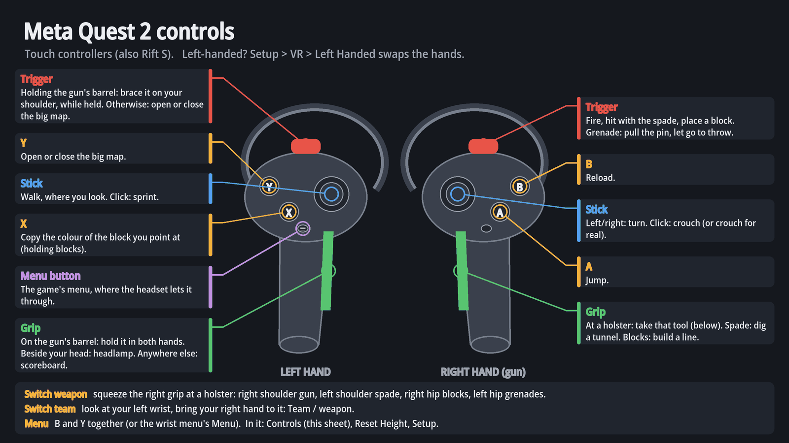
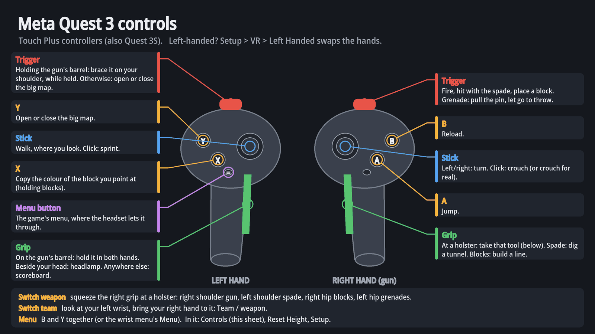
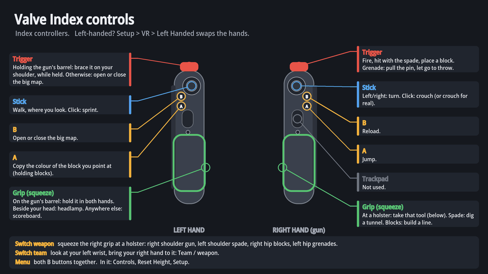
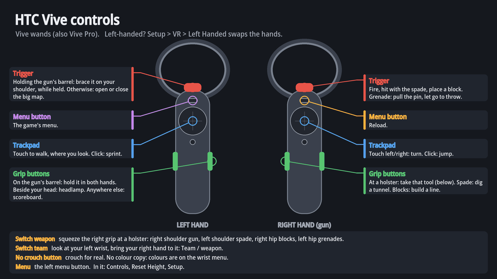
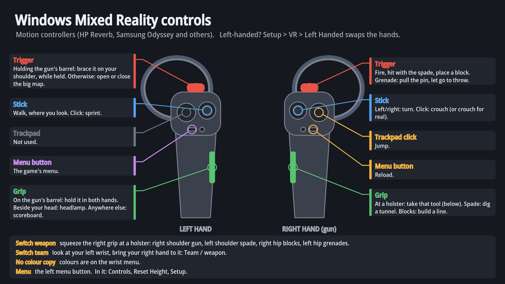
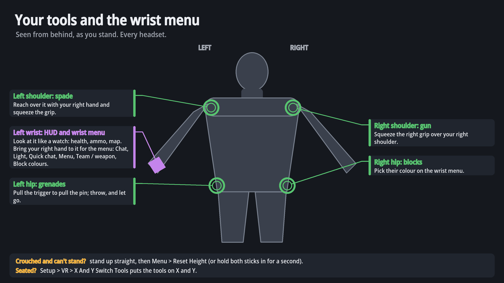

# VR controls: cheat sheet and first game

In a game, the menu (B and Y together) has a **Controls** button that shows the
pictures below, starting with the one for your controllers. The main menu's
**Training** course teaches the same things hands-on. Everything here is for the
right hand holding the gun; **Setup > VR > Left Handed** swaps the hands.

## Cheat sheet

| | Left hand | Right hand (gun) |
|---|---|---|
| Trigger | holding the gun's barrel: brace the gun on your shoulder, held; otherwise: big map, open/close | fire; spade: hit; blocks: place; grenade: pull the pin, let go to throw |
| Grip | on the gun's barrel: both hands on the gun; beside your head: headlamp; anywhere else: scoreboard | at a holster: take that tool; spade: dig a tunnel; blocks: build a line |
| Stick | walk, where you look; click: sprint | left/right: turn; click: crouch (or crouch for real) |
| A / X | X: copy the colour of the block you point at | A: jump |
| B / Y | Y: big map, open/close | B: reload |
| B and Y together | the game's menu: Controls, Reset Height, Setup, Disconnect | |
| Both sticks in for a second | recentre: your height and the middle of the room | |

**Switching weapon**: tools are on your body. Squeeze the right grip with your
hand over your right shoulder for the gun, over your left shoulder for the
spade, at your right hip for blocks, at your left hip for grenades. The
controller buzzes when your hand is at one. Seated, with the holsters out of
reach? **Setup > VR > X And Y Switch Tools** puts the tools on X and Y.

**Switching team, or gun**: look at your left wrist as you would at a watch,
bring your right hand to it, and touch **Team / weapon**.

**The wrist menu** (left wrist, right hand close to it): Chat, Team chat, Light
(headlamp), Quick chat, Menu, Team / weapon, and the block colours.

### Other controllers

| | Valve Index | HTC Vive wands | Windows Mixed Reality |
|---|---|---|---|
| Jump | right A | right trackpad click | right trackpad click |
| Reload | right B | right menu button | right menu button |
| Turn | right stick | right trackpad, touch left/right | right stick |
| Crouch | right stick click | crouch for real | right stick click |
| Walk / sprint | left stick / its click | left trackpad / its click | left stick / its click |
| Copy colour / big map | left A / left B | (wrist menu for colours; left trigger for the map) | (wrist menu for colours; left trigger for the map) |
| Menu | both B buttons | left menu button | left menu button |

Triggers and grips are as on a Quest. Index grips are a squeeze of the handle;
the Index trackpads and the WMR left trackpad are not used.

### Pictures

| | |
|---|---|
|  |  |
|  |  |
|  |  |

They are drawn by `tools/vr-controls/make_controls.py`; run it again after a
control changes (`py tools/vr-controls/make_controls.py`).

## Your first game

1. **Stand up straight** before you join: the game takes the height your head
   is at as standing. If you ever find yourself crouching however straight you
   stand (after taking the headset off, say), stand up and press
   **Menu > Reset Height**.
2. **Join a server.** The team and weapon screen comes up: point at it with
   either controller and pull the trigger to pick.
3. **Look at your left wrist.** Health and ammo are on it like a watch, with the
   minimap and the chat above them.
4. **Move.** The left stick walks where you look; click it to sprint. The right
   stick turns. Duck for real, or click the right stick, to crouch. A jumps.
5. **Shoot.** Point the gun and pull the right trigger. The red laser shows where
   the shot lands; it turns amber while you reload (B). Put your left hand on
   the barrel and squeeze its grip to hold the gun in both hands; with the
   rifle, bring your eye behind the scope.
6. **Change tools** at the holsters: right grip over your left shoulder takes
   the spade. Pull the trigger, or swing it, to hit a block; hold the grip to
   dig a tunnel ahead. At your right hip, blocks: the trigger places one, the
   grip draws a line. Pick their colour on the wrist menu. Over your right
   shoulder, the gun again.
7. **Throw a grenade**: take one from your left hip, pull the trigger to pull
   the pin, throw, and let go.
8. **Look around**: Y (or the left trigger, when your left hand is not on the
   gun) opens the big map, held in your left hand; the left grip shows the
   scores. With both hands on a gun, hold the left trigger to brace it on your
   shoulder: steadier, as the rifle's stock is.
9. **Talk and switch teams** on the wrist menu.
10. **Forgot something?** B and Y together, then **Controls**.

## If something is off

- **Crouching all the time**: stand up straight, **Menu > Reset Height**.
- **Up close the dot sits a little off the barrel**: the shot leaves your eye,
  along the gun, so that anything your eyes see over (a wall, a window sill)
  the shot clears too. The dot is always where it lands.
- **Snow or white blocks too bright**: **Setup > VR > Brightest Blocks**
  (75% by default; lower is dimmer, takes effect on the next map).
